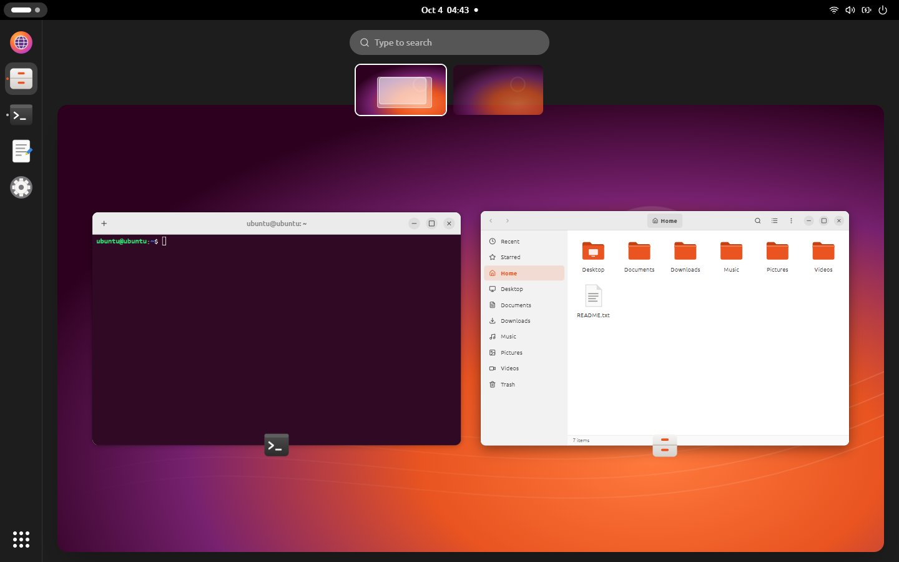
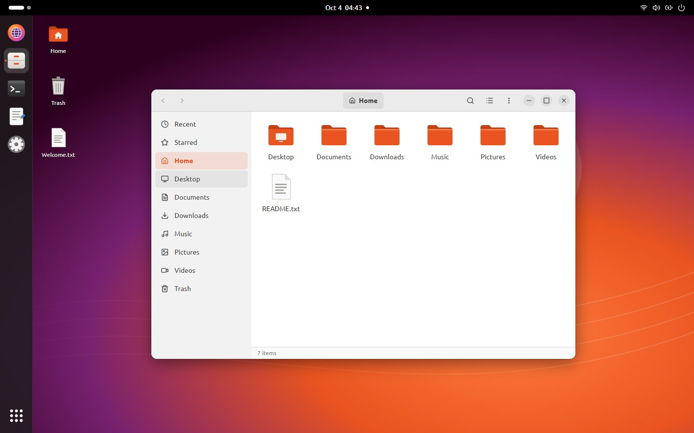
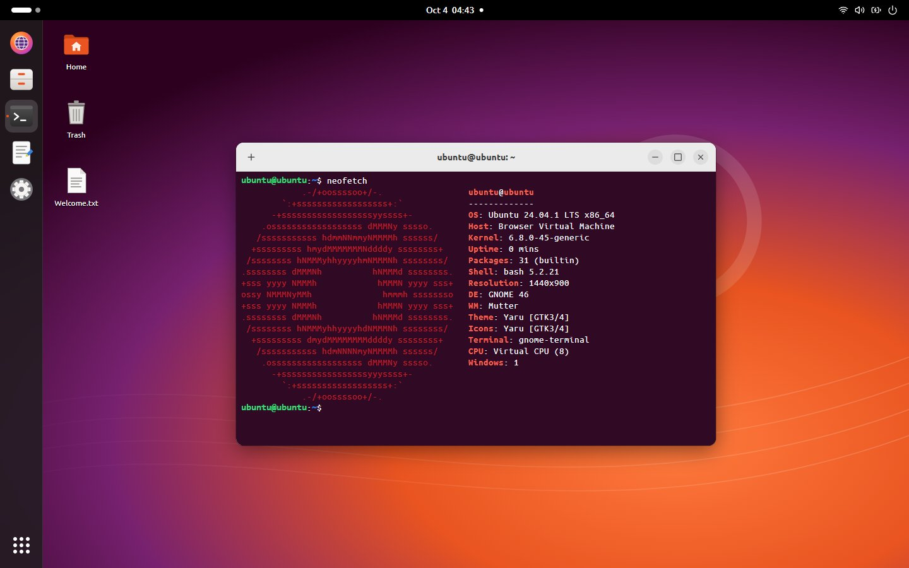
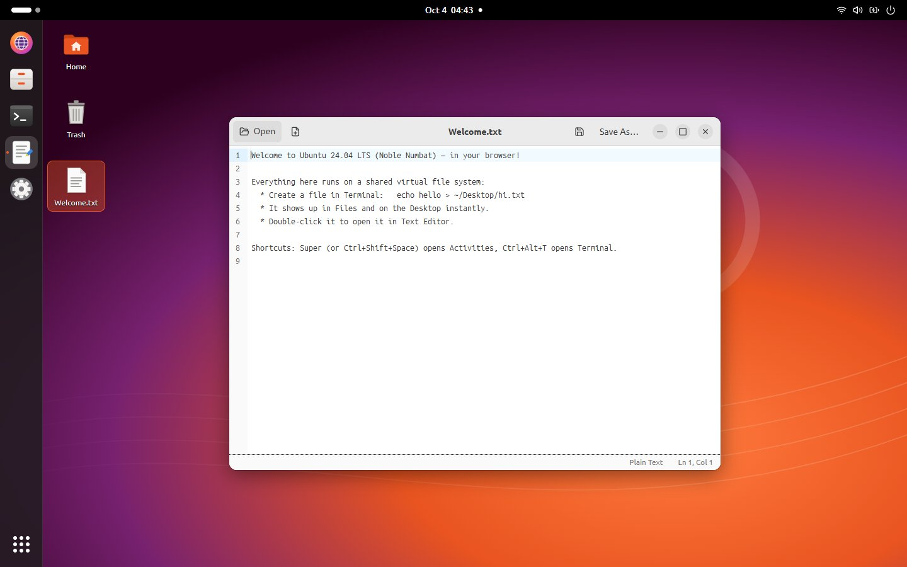
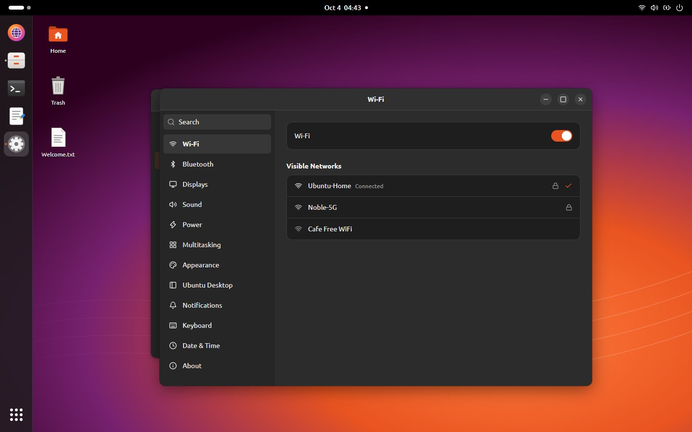
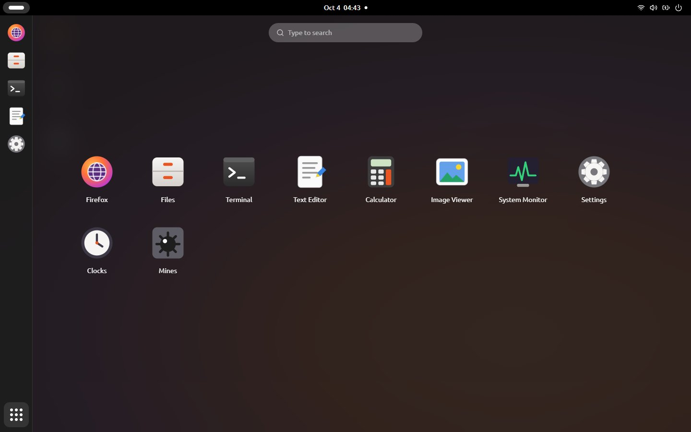
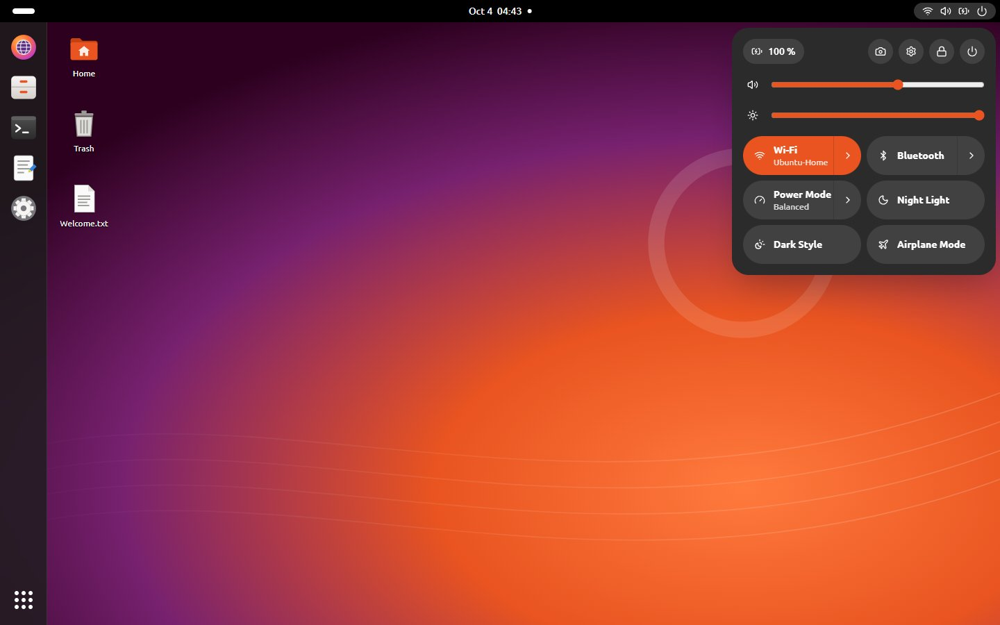

# React ile Ubuntu 24.04

Ubuntu 24.04 LTS masaüstünün (GNOME 46, Yaru, Ubuntu Dock) tarayıcıda çalışan bir kopyası. Uygulamaların hepsi
aynı sanal dosya sistemini kullanır. Terminal'de oluşturduğun dosya Files'ta hemen görünür, orada çift tıklayınca
Text Editor'de açılır, kaydettikten sonra `cat` yeni içeriği basar.

Sunucu tarafı yok. Her şey tarayıcıda çalışır ve `localStorage`'a kaydedilir.

Canlı demo: <https://mihrimatrix.github.io/ubuntu-react/> (giriş ekranında herhangi bir parola olur).



|                                                                                                          |                                                                                                                         |
| -------------------------------------------------------------------------------------------------------- | ----------------------------------------------------------------------------------------------------------------------- |
|  **Files**: breadcrumb, arama, dikdörtgen seçim, sürükle-bırak            |  **Terminal**: ortak dosya sistemi üzerinde bash benzeri kabuk |
|  **Text Editor**: sekmeli ve sözdizimi renklendirmeli CodeMirror 6 |  **Settings**: 12 panel, koyu tema, duvar kâğıtları, dock seçenekleri      |
|  Aramalı **App Grid**                                                   |  Alt menülü **Quick Settings**                                                  |

## Hızlı başlangıç

### GitHub Pages

`main`'e her push'ta `.github/workflows/pages.yml` uygulamayı Bun ile derleyip GitHub Pages'e yükler. Workflow
`SITE_URL`'i `https://mihrimatrix.github.io/ubuntu-react` olarak verir, böylece link önizlemeleri doğru görseli
bulur. Fork'ta kullanacaksan bu değeri kendi adresinle değiştir ve repo ayarlarında Pages kaynağını
"GitHub Actions" yap.

### Docker Compose

```bash
echo "SITE_URL=https://ubuntu.example.com" > .env   # isteğe bağlı, aşağıya bak
docker compose up -d --build
# http://localhost:8080 adresini aç ve herhangi bir parolayla giriş yap
```

| `.env` değişkeni | Varsayılan | Amaç                                                                                                                        |
| ---------------- | ---------- | --------------------------------------------------------------------------------------------------------------------------- |
| `SITE_URL`       | boş        | Build sırasında gömülen genel URL; link önizlemeleri mutlak görsel URL'si alır (Facebook, LinkedIn, X ve Slack bunu ister). |
| `PORT`           | `8080`     | Sunucudaki port.                                                                                                            |

Container uygulamayı yalnızca düz HTTP ile sunar. Alan adı ve TLS için önüne bir reverse proxy koy.
Nginx Proxy Manager kullanıyorsan sunucunun IP'sine ve `PORT`'a (NPM aynı Docker ağındaysa `ubuntu-react:8080`'e)
yönlendiren bir Proxy Host ekle ve SSL sertifikasını orada al.

İmaj iki aşamalıdır: Bun bundle'ı derler, aynı Bun imajı da `server.ts`'yi `node_modules` olmadan, root olmayan
`bun` kullanıcısıyla çalıştırır. `HEALTHCHECK` tanımlıdır.

### Yerel geliştirme

Bun ≥ 1.3 gerekir.

```bash
bun install
bun dev              # HMR'li geliştirme sunucusu (bun ./index.html)
bun test             # birim + happy-dom bileşen testleri
bun run typecheck
bun run build        # dist/ içine production bundle (mutlak sosyal URL'ler için SITE_URL=…)
bun run e2e          # gerçek Chrome'da uçtan uca senaryo (`bun dev` açık olmalı)
bun run e2e:mouse    # masaüstü ikonu ve pencere başlık çubuğu fare kontrolleri (başka sunucu için URL=…)
bun run shots        # her sahnenin ekran görüntüsünü e2e/shots/ içine kaydeder
```

`e2e`, `e2e:mouse` ve `shots`, kurulu Google Chrome'u `playwright-core` ile sürer (tarayıcı indirmez).
README görselleri de aynı betikten gelir:

```bash
DIR=docs/screenshots EXT=jpg bun e2e/shot.ts overview files terminal editor dark grid quick
SIZE=1200x630 DIR=public bun e2e/shot.ts overview && mv public/overview.png public/og.png
```

## Performans ve sunum

Bun'ın CSS bundler'ı her `url()`'i base64 olarak gömer; @fontsource'un tüm alt kümeleri bu yüzden 1,7 MB'lık CSS'e
dönüşüyordu. `build.ts` woff2 fontları yeniden ayrı dosyalara çıkarır ve woff yedeklerini atar. Tarayıcı da
`unicode-range` sayesinde yalnızca sayfanın kullandığı alt kümeleri indirir.

Her uygulama `lazy()` ile yüklenir. CodeMirror (≈670 KB) ve xterm (≈490 KB), Text Editor ya da Terminal ilk kez
açılana kadar inmez.

Docker imajındaki `server.ts`, build sırasında gzip'lenen (seviye 9) dosyaların `.gz` kopyasını gzip kabul eden
istemciye gönderir. Hash'li dosyaları bir yıl `immutable` olarak önbelleğe aldırır, `index.html`'i her yüklemede
yeniden doğrulatır ve `X-Content-Type-Options` ile `Referrer-Policy` başlıklarını ekler. Olmayan dosyaya 404,
kodlanmış `..` içeren yola 400 döner. Source map'ler imaja girmez.

## SEO ve link önizlemeleri

`index.html` açıklama, canonical URL, `theme-color`, SVG favicon, Open Graph ve Twitter kart etiketleri ile bir
`<noscript>` yedeği içerir. Önizleme görseli `public/og.png` (1200×630). Build, `%SITE_URL%` ifadesini `SITE_URL`
değeriyle değiştirir.

## Ek bağımlılıklar

| Paket                                                               | Neden                                                                                                                                                                                               |
| ------------------------------------------------------------------- | --------------------------------------------------------------------------------------------------------------------------------------------------------------------------------------------------- |
| `@codemirror/state`, `/view`, `/search`, `lang-*`, `theme-one-dark` | Editörün doğrudan kullandığı CodeMirror 6 parçaları (diller, koyu tema, arama paneli).                                                                                                              |
| `@xterm/addon-webgl`                                                | Resmi xterm renderer'ı. DOM renderer Ubuntu Mono karakterlerini yanlış ölçüp sütunları kaydırıyordu (`neofetch`'te görünür); WebGL her karakteri kendi hücresine çizer. Desteklenmezse DOM'a döner. |
| `@happy-dom/global-registrator` (dev)                               | `bun test` içindeki bileşen testleri için DOM.                                                                                                                                                      |
| `playwright-core` (dev)                                             | e2e kontrolleri ve ekran görüntüleri için kurulu Chrome'u sürer.                                                                                                                                    |

## Mimari

```mermaid
flowchart LR
  subgraph Saf mantık, birim testli
    fs[os/fs.ts<br/>VFS]
    shell[lib/shell.ts + commands<br/>yorumlayıcı]
    calc[lib/calc.ts<br/>shunting-yard]
    snap[lib/snap.ts<br/>pencere geometrisi]
    mines[lib/mines.ts]
  end
  store[(os/store.ts<br/>zustand + persist)]
  storage[os/storage.ts<br/>localStorage adaptörü]
  registry[apps/registry.ts<br/>AppDef listesi]
  shellui[shell/*<br/>Desktop, TopBar, Dock, Window,<br/>Overview, AppGrid, AltTab, Session]
  apps[apps/*<br/>lazy yüklenen bileşenler]
  keyboard[os/keyboard.ts<br/>kısayol tablosu]

  fs --> store
  store --> storage
  shell --> apps
  calc --> apps
  snap --> shellui
  registry --> shellui
  registry --> apps
  store <--> shellui
  store <--> apps
  keyboard --> store
```

Uygulamalar, dock, App Grid, arama, "Open With" ve MIME yönlendirmesi `apps/registry.ts` içindeki `APPS`
listesinden okunur. Yeni bir uygulama eklemek için registry'ye bir kayıt ve bir bileşen dosyası yeter. Kısayollar
tek bir tabloda durur (`os/keyboard.ts`), sağ tık menüleri de tek bir `ContextMenu`'ye verilen düz dizilerdir.

VFS, kabuk, hesap makinesi, pencere geometrisi, Overview yerleşimi, Files'taki seçim ve sıralama, URL
normalleştirme ve Mines, testleri olan düz fonksiyonlardır. Arayüz bunları çağırır ve sonucu store'a yazar.

Store iki dosyada: `os/store.ts` VFS'i, ayarları, bildirimleri, oturumu ve menüleri tutar, `os/windows.ts` pencere
yöneticisinin dilimidir. Kalıcı olan yalnızca VFS, ayarlar, terminal geçmişi ve masaüstü ikon konumlarıdır; bunlar
`version` ve `migrate` ile saklanır. Storage adaptörü kalıcı bir şey değişmediyse yazmaz ve 5 MB'a yaklaşınca uyarır.
IndexedDB'ye geçmek istersen yalnızca `os/storage.ts`'yi değiştirmen gerekir.

Pencere taşıma ve boyutlandırma, masaüstü ikonu sürükleme ve masaüstünde dikdörtgen seçim `os/useDragResize.ts`
içindeki `track()`'i paylaşır. İşaretçi ancak sürükleme eşiği aşılınca yakalanır, bu yüzden düz tıklamalar başlık
çubuğundaki düğmelere ulaşır. Yakalandıktan sonra hareket iframe'lerin ve terminallerin üstünde de sürer. Pencere
sürüklenirken yalnızca CSS `transform` değişir; store'a `pointerup`'ta yazılır. `rect` her zaman pencerenin normal
geometrisini tutar, maksimize ve snap halleri bundan hesaplanır. Küçültülen pencereler mount'lu kalır, böylece
terminal geçmişi ve editörün geri alma geçmişi kaybolmaz.

Masaüstü ikonları sütun öncelikli bir ızgaraya dizilir. Tıklayarak, Ctrl+tıklayarak ya da dikdörtgen çizerek
seçilir ve seçim toplu halde boş hücrelere, Çöp'e ya da bir klasöre sürüklenir. İlk sürüklemede bütün ikonların
hücresi kaydedildiği için hiçbiri yer değiştirmez. Yeni dosyalar ilk boş hücreye yerleşir.

## Uygulamalar

Files, Terminal, Text Editor, Firefox, Calculator, Image Viewer, Settings ve System Monitor, ayrıca bonus olarak
Clocks ve Mines. Uygulamalar `shell/chrome.tsx` içindeki ortak bileşenleri kullanır: header bar yuvaları,
diyaloglar, sekme şeritleri, segmentli seçiciler ve bir hata sınırı. Bir uygulama çökerse masaüstü ayakta kalır,
pencerede "has stopped" mesajı çıkar.

GNOME'dan alınıp sonuna kadar çalışır hale getirilen davranışlar şunlar: sıcak köşe, Screen Blank süresi dolunca
otomatik kilit, kaçırılan bildirimleri sayan kilit ekranı, pencere menüsünde Always on Top ve Move to Workspace,
dock'un yüzen (panel olmayan) modu, sürükle-bırak ile çalışan Çöp ve OSD gösteren ses ve parlaklık tuşları. Tarayıcı
Battery Status API'yi destekliyorsa pil durumu da gerçektir.

## Bilinen kısıtlar

- Birçok site `X-Frame-Options` ya da CSP `frame-ancestors` gönderdiği için iframe içinde açılmaz (Google, GitHub,
  ubuntu.com, MDN, kernel.org…). Firefox bu durumda "Open in New Tab" düğmeli bir hata sayfası gösterir. Ana sayfa
  ve yer imlerinde yalnızca gömülmeye izin verdiğini doğruladığım siteler var (Wikipedia, OpenStreetMap, DuckDuckGo
  HTML, Internet Archive, Hacker News, info.cern.ch, wiki.ubuntu.com). Başka origin'den gelen bir sayfanın içinde
  gezinince adres çubuğu güncellenmez.
- Super, Alt+Tab, Alt+F4 ve Ctrl+Alt+T'yi işletim sistemi ya da tarayıcı önce yakalayabilir. Tam ekranda
  Chromium'un Keyboard Lock API'si bunları sayfaya iletir. Her kısayolun tarayıcıyla çakışmayan bir karşılığı da var
  ve Settings › Keyboard'da listelenir; örneğin Etkinlikler için Ctrl+Shift+Space, Alt+Tab için Alt+\`.
- `localStorage` yaklaşık 5 MB'tır. Data URL olarak saklanan büyük görseller bunu çabuk doldurur.
- Terminalin satır editörü komutun tek satıra sığdığını varsayar; satır kayınca imleci takip etmez.
- Dolu bir hücreye bırakılan masaüstü ikonu yerinde kalır. Ubuntu'nun masaüstü ikonları (DING) onu bir sonraki boş
  hücreye iterdi.
- Masaüstü istemci tarafında çizildiği için JavaScript çalıştırmayan arama motoru botları yalnızca meta
  etiketlerini ve `<noscript>` metnini görür.

## Lisans ve emeği geçenler

Kod MIT lisanslıdır. İkonlar [Yaru](https://github.com/ubuntu/yaru) ikon teması (CC BY-SA 4.0) tarzında çizildi;
orijinal Yaru ikonlarını aynı dosya adlarıyla `public/yaru-icons/` içine koyarsan onlar kullanılır. Fontlar
@fontsource üzerinden gelen Ubuntu ve Ubuntu Mono'dur (Ubuntu Font Licence).

Ubuntu ve Circle of Friends logosu Canonical Ltd.'nin ticari markalarıdır. Bu kişisel ve eğitim amaçlı bir projedir;
Canonical ile bağlantılı değildir ve Canonical tarafından onaylanmamıştır.
